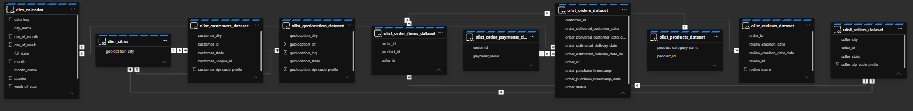

Olist Executive Dashboard: Sales, Retention & Delivery Performance
An interactive Streamlit dashboard built on the Olist Brazilian e-commerce dataset. The data was modeled in Microsoft Fabric following a medallion architecture, and the curated gold layer was exported as Parquet files that feed the app. The app also includes a chat powered by Groq AI that answers questions grounded in the dashboard data.
---
Table of Contents
Architecture Overview
Repository Structure
Data Engineering in Microsoft Fabric
Gold Layer Tables
Semantic Model
Streamlit Dashboard
AI Chat (Groq)
Design Decisions & Considerations
Running the App
Known Limitations
---
Architecture Overview
```
Kaggle (Olist dataset, static)
        │
        ▼
Microsoft Fabric ── Medallion ETL (Spark notebooks)
   Bronze → Silver → Gold (curated)
        │
        ├── Semantic model on top of the gold tables
        ├── SQL analytics endpoint (created, not consumed)
        │
        ▼
Gold tables exported as .parquet  →  /data
        │
        ▼
Streamlit app (app.py)  +  Groq AI chat
```
Repository Structure
Path	Description
`app.py`	Streamlit dashboard (KPIs, monthly revenue, interactive map, AI chat).
`data/`	Gold-layer Parquet files read by the app.
`layers/`	Medallion-architecture files from the Fabric ETL development.
`notebooks/`	Spark notebooks from Microsoft Fabric (includes the creation of the calendar and cities dimensions).
`docs/`	Documentation assets, such as the semantic model diagram.
`requirements.txt`	Python dependencies.
Data Engineering in Microsoft Fabric
The data comes from the public Olist Brazilian E-Commerce dataset on Kaggle. The ETL was developed in Microsoft Fabric using a medallion structure (bronze → silver → gold). The files of each layer are stored in the `layers` folder of this repository, and the Spark notebooks are in the `notebooks` folder.
Two dimension tables were created inside the Spark notebook in Microsoft Fabric:
`dim_calendar`: a date dimension (date key, day name, day of month, day of week, full date, month, month name, quarter, week of year).
`dim_cities`: a city dimension built from the geolocation city names.
Why Parquet files instead of the SQL endpoint?
The Parquet files in `data/` correspond to the gold (curated) layer. The Fabric SQL analytics endpoint was created, but the app does not consume it because:
The workspace runs on a trial Fabric capacity.
There is no tenant admin access, so Fabric capacity groups cannot be assigned and external access to the endpoint cannot be configured.
Exporting the gold tables to Parquet and serving them from the repository keeps the app self-contained and deployable on Streamlit Community Cloud without Fabric credentials.
No watermarks / incremental loading
No watermarks were added to the pipelines. The source is a static Kaggle dataset, so no new records arrive and there is nothing to track incrementally. Full loads are sufficient.
Gold Layer Tables
Table	Description
`olist_orders_dataset`	Orders with status and purchase, delivery and estimated-delivery dates.
`olist_order_items_dataset`	Items per order (order, product and seller keys).
`olist_order_payments_dataset`	Payment value per order.
`olist_customers_dataset`	Customers with unique ID, city, state and zip prefix.
`olist_products_dataset`	Products with category name.
`olist_reviews_dataset`	Order reviews and scores.
`olist_sellers_dataset`	Sellers with city, state and zip prefix.
`olist_geolocation_dataset`	Zip prefix, latitude/longitude, city and state.
`dim_calendar`	Date dimension (created in the Fabric Spark notebook).
`dim_cities`	City dimension (created in the Fabric Spark notebook).
> The dashboard (`app.py`) reads orders, order items, payments, customers and products. The remaining tables are part of the gold layer and the semantic model, but are not required by the current app.
Semantic Model
A semantic model was developed in the gold layer on top of the tables listed above, relating the fact tables (orders, items, payments, reviews) with their customer, product, seller, geography and date dimensions.

Streamlit Dashboard
KPIs (top row)
Total revenue
Average purchase price (average value per order)
On-time delivery rate (% of deliveries that met the promised date)
Repurchase rate within 3 months, 7 months and 2 years of the first purchase
Top 5 most purchased products
Monthly revenue chart
Interactive choropleth / bubble map
Switch the view by State or by City.
Choose which variable to display: revenue, average purchase price, on-time delivery %, or repurchase rate (3 months, 7 months, 2 years).
State view: choropleth over Brazil's state boundaries (GeoJSON).
City view: bubbles where size = number of orders and color = selected variable, with a slider to hide cities with few orders.
Clean light basemap (Carto Positron, no API token required), zoom and pan.
The map filters the rest of the dashboard: click a state or city (Shift + click for several) and the KPIs, top 5 and monthly revenue update. A banner and a Clear selection button manage the active filter. The map itself always shows all data so any other area can be selected.
AI Chat (Groq)
The dashboard includes a chat box built with Streamlit's `st.chat_input`.
Model: `openai/gpt-oss-120b` served through Groq.
Input limited to 400 characters.
The model receives a compact summary computed with pandas (totals, top categories, states, cities and months with units, revenue and on-time %), not the raw tables. This keeps the prompt small and the answers grounded in the data.
The summary reflects the current map selection, so questions are answered for the filtered area.
The system prompt instructs the model to answer only from the supplied data and to say so when the data cannot answer the question.
The API key is read from the `API_K` environment variable (Streamlit secrets); it is never stored in the code.
Design Decisions & Considerations
Revenue source: `olist_order_items` has no price column, so revenue is calculated from `payment_value` in the payments table at order level, avoiding duplicated revenue on multi-item orders. For item-level analysis, an order's payment is split evenly across its items.
Excluded orders: orders with status `canceled` and `unavailable` are excluded from all calculations.
On-time delivery: compared by date (the estimated date has no time component), only for delivered orders.
Repurchase rate: % of unique customers (`customer_unique_id`) who placed a second order within 90 / 210 / 730 days of their first order. Only customers whose window could already be completed are counted. The dataset ends in 2018, so no customer has a full 2-year follow-up; in that case all customers are used as an approximation, and the app flags it.
Product names: the dataset has no product name, so the category name is shown. When two products share a category they are numbered, e.g. "Ferramentas Jardim (2)".
City coordinates: the Parquet files do not include usable coordinates for the city map, so city coordinates come from the public Brazilian municipalities dataset `kelvins/municipios-brasileiros`, matched by normalized city name and state (≈99.9% of orders matched with the default threshold). State boundaries come from a public Brazil states GeoJSON.
No sidebar: all controls live in the main page; methodology notes appear at the bottom of the dashboard.
Performance: data is loaded and joined once with Streamlit caching.
Running the App
```bash
git clone https://github.com/davidalejo04/NearShiftTest.git
cd NearShiftTest
pip install -r requirements.txt
export API_K="your_groq_api_key"      # required only for the AI chat
streamlit run app.py
```
Suggested `requirements.txt`:
```
streamlit>=1.40
plotly>=5.24
pandas
pyarrow
groq
```
Data loading: the app reads the Parquet files from a local `data/` folder (or the folder in the `DATA_DIR` environment variable) and falls back to the repository's raw GitHub URLs.
Known Limitations
The SQL analytics endpoint of the Fabric lakehouse is not used (trial capacity, no tenant admin access).
Data is static (Kaggle snapshot); there is no incremental refresh.
The 2-year repurchase rate is an approximation because of the dataset's time span.
The AI chat only sees the summarized data (top categories, states, top cities and months); it cannot answer questions about individual products or sellers.
City and state maps require internet access to load the GeoJSON, municipality coordinates and map tiles.
